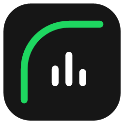
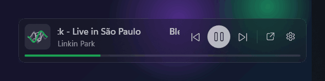
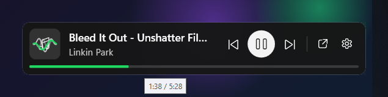
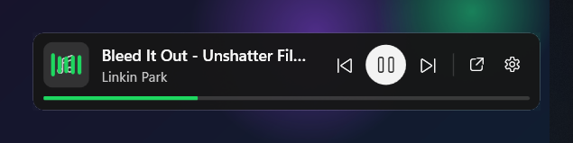
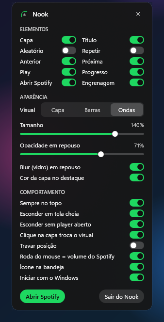

<div align="center">



# Nook

**Um mini player de vidro fosco para o Spotify que mora num cantinho da sua tela.**

Pause, pule e veja o que está tocando sem nunca mais abrir o Spotify.

[](https://github.com/solanosolutions/nook/releases/latest)
[](#-download)
[](LICENSE)
[](https://github.com/solanosolutions/nook/stargazers)



[**Download**](https://github.com/solanosolutions/nook/releases/latest) · [Recursos](#-recursos) · [Como usar](#-como-usar) · [Dúvidas](#-dúvidas-frequentes) · [Roadmap](#-roadmap) · [English](README.md)

</div>

---

## Por que o Nook?

Eu escuto música o dia inteiro enquanto trabalho. Toda vez que queria pausar ou pular, tinha que caçar o Spotify na barra de tarefas: um app inteiro aberto só para apertar um botão. Os mini players que testei eram pesados, feios ou pediam login com chave de API.

Então criei o que eu queria: **minimalista, bonito e invisível até você precisar dele.**

- 🪶 **Levíssimo.** ~30–60 MB de RAM e **menos de 1% de CPU**, mesmo com o visualizador ao vivo. O próprio Spotify usa 10× mais.
- 🔑 **Zero configuração.** Sem login, sem chave de API, sem vincular conta. Abriu, funcionou.
- 🫥 **Não atrapalha.** Não aparece na barra de tarefas nem no Alt+Tab, e se esconde sozinho quando você assiste a um filme em tela cheia.

## ✨ Recursos

| | |
|---|---|
| 🧊 **Vidro fosco** | Translúcido e desfocado em repouso; nítido e sólido assim que o mouse chega. |
| 🎵 **Visualizador ao vivo** | Barras ou ondas que reagem ao áudio *de verdade*, capturado **só do Spotify** (notificações e vídeos não interferem). |
| 🎨 **Cor da capa** | Barra de progresso e visualizador assumem a cor dominante da capa atual. |
| 📜 **Título rolando** | Nomes longos rolam suavemente; passe o mouse para congelar. |
| 🖱️ **Roda = volume** | A roda do mouse sobre o player muda **só o volume do Spotify**, não o do PC inteiro. |
| 🎬 **Respeita a tela cheia** | Some sozinho quando um filme, jogo ou apresentação entra em tela cheia no monitor dele. |
| 💤 **Some quando pausado** | Ficou pausado um tempo (1, 5 ou 15 min)? Ele sai da frente e volta no próximo play. Ou use o botão esconder. |
| ↕️ **Horizontal ou vertical** | Escolha uma barra larga ou um cartão em pé com a capa grande, ótimo ao lado de uma barra de tarefas vertical. |
| 🧲 **Arraste para onde quiser** | Gruda nas bordas da tela e lembra a posição. |
| 🎛️ **Totalmente configurável** | Escolha botões, tamanho, opacidade em repouso, blur, estilo do visual e mais. |
| ⏱️ **Timer de foco** | Opcional: uma pílula de vidro acima do player. 5, 10, 25 min ou o tempo que você digitar; um toque suave quando acaba. |
| 🌐 **Inglês e português** | Segue o idioma do Windows automaticamente, ou escolha nas configurações. |
| 🚀 **Inicia com o Windows** | Opcional, um clique. |

<div align="center">
&nbsp;&nbsp;
</div>

## 📥 Download

1. Baixe o **`Nook.exe`** na [última versão](https://github.com/solanosolutions/nook/releases/latest).
2. Coloque em qualquer pasta (ex.: `Documentos\Nook`) e dê dois cliques.
3. Pronto. Toque algo no Spotify e o Nook aparece no canto inferior direito.

Sem instalador e sem precisar instalar o .NET: vai tudo dentro de um único `.exe`.

> **"O Windows protegeu o computador"?** O Nook é gratuito e de código aberto, mas ainda não tem assinatura digital (os certificados são caros), então o SmartScreen avisa sobre qualquer app novo sem assinatura. Clique em **Mais informações → Executar assim mesmo**. Você pode conferir o arquivo pelo SHA-256 publicado em cada versão, ou [compilar você mesmo](#-compilar-a-partir-do-código).

**Requisitos:** Windows 10 (2004+) ou Windows 11, x64. O visualizador ao vivo precisa do **Windows 11**; no Windows 10 o Nook mostra a capa do álbum.

> 🍎🐧 **macOS e Linux em breve.** Hoje o Nook roda só no Windows. [Dê uma estrela](https://github.com/solanosolutions/nook/stargazers) ou acompanhe as versões para saber quando chegarem.

## 🖱️ Como usar

| Ação | O que faz |
|---|---|
| **Arrastar** | Move o player para qualquer lugar |
| **Duplo clique** ou **botão direito** | Abre as configurações |
| **Clique na capa** | Troca o visual: capa → barras → ondas |
| **Roda do mouse** | Sobe / desce o volume do Spotify |
| **Clique na barra de progresso** | Pula para aquele ponto da música |
| **Botão esconder** (—) | Esconde na hora; volta no próximo play |
| **Ícone na bandeja** | Mostrar / esconder, configurações, sair |

<details>
<summary><b>⚙️ Ver o menu de configurações</b></summary>
<br>

</details>

## 🔒 Privacidade

- O Nook conversa **só com o Windows**: ele lê o que está tocando pelos mesmos controles de mídia que o painel de volume do Windows usa.
- O visualizador analisa o áudio **na memória, em tempo real**. Nada é gravado, salvo ou enviado.
- Sem telemetria, sem contas, sem acesso à internet. As configurações ficam em `%AppData%\Nook\settings.json`.

## ❓ Dúvidas frequentes

<details>
<summary><b>Funciona com outros apps além do Spotify?</b></summary>

Sim. O Nook prioriza o Spotify, mas se ele não estiver aberto, controla o que estiver tocando (YouTube no navegador, outros players), e a roda do mouse passa a mexer no volume do sistema.
</details>

<details>
<summary><b>Preciso do Spotify Premium?</b></summary>

Não. O Nook usa só os controles de mídia padrão do Windows, então funciona com o Spotify gratuito também.
</details>

<details>
<summary><b>O player sumiu!</b></summary>

Provavelmente ele se escondeu sozinho: ou algo está em tela cheia, ou nenhum player está aberto (Spotify fechado). Use o ícone da bandeja para mostrá-lo, ou desligue essas opções nas configurações.
</details>

<details>
<summary><b>Como desinstalo?</b></summary>

Desligue "Iniciar com o Windows" nas configurações, saia pelo ícone da bandeja e apague o `Nook.exe` e a pasta `%AppData%\Nook`. Só isso, nada mais é alterado.
</details>

## 🗺️ Roadmap

- [x] Widget de vidro fosco, arrastar, ímã nas bordas, bandeja
- [x] Visualizador de áudio ao vivo (captura só do Spotify)
- [x] Cor da capa, título rolando, volume só do Spotify
- [x] Esconde em tela cheia / quando nada está aberto
- [x] 🌐 Interface em inglês e português (segue o idioma do Windows)
- [x] ⏱️ Timer de foco (5 / 10 / 25 min ou personalizado), discreto como o player
- [x] ↕️ Layout vertical e esconder quando pausado
- [ ] 🍎 Versão para macOS
- [ ] 🐧 Versão para Linux
- [ ] ❤️ Botão de curtir (login opcional no Spotify)
- [ ] Versões com assinatura digital

Tem uma ideia? [Abra uma issue](https://github.com/solanosolutions/nook/issues/new/choose). Sugestões são muito bem-vindas.

## 🛠️ Compilar a partir do código

Precisa do [.NET 8 SDK](https://dotnet.microsoft.com/download/dotnet/8.0) no Windows.

```powershell
git clone https://github.com/solanosolutions/nook.git
cd nook
dotnet run --project src -c Release                                    # roda
powershell -ExecutionPolicy Bypass -File tools\publish.ps1             # gera o Nook.exe independente
```

**Como funciona:** WPF/.NET 8. Informações e controles de reprodução vêm do [System Media Transport Controls](https://learn.microsoft.com/uwp/api/windows.media.control) do Windows; o visualizador usa o *process loopback* do WASAPI para capturar só o áudio do Spotify e uma FFT pequena; o volume usa as sessões do Core Audio. Sem dependências de terceiros.

## 🤝 Contribuindo

Issues e pull requests são bem-vindos! Relatos de bug com passos para reproduzir (e o `%AppData%\Nook\error.log`, se existir) ajudam muito.

## ⭐ Curtiu?

Se o Nook deixou seu dia um pouco mais tranquilo, **[deixe uma estrela](https://github.com/solanosolutions/nook/stargazers)**. É de graça, leva um clique e ajuda outras pessoas a encontrá-lo. 🙏

---

<div align="center">
<sub>Feito com ☕ e 🎧 por <a href="https://github.com/solanosolutions">Lucas Solano</a> · Licença MIT<br>
O Nook é um projeto independente, sem afiliação, endosso ou patrocínio do Spotify AB. Spotify é marca registrada do Spotify AB.</sub>
</div>
